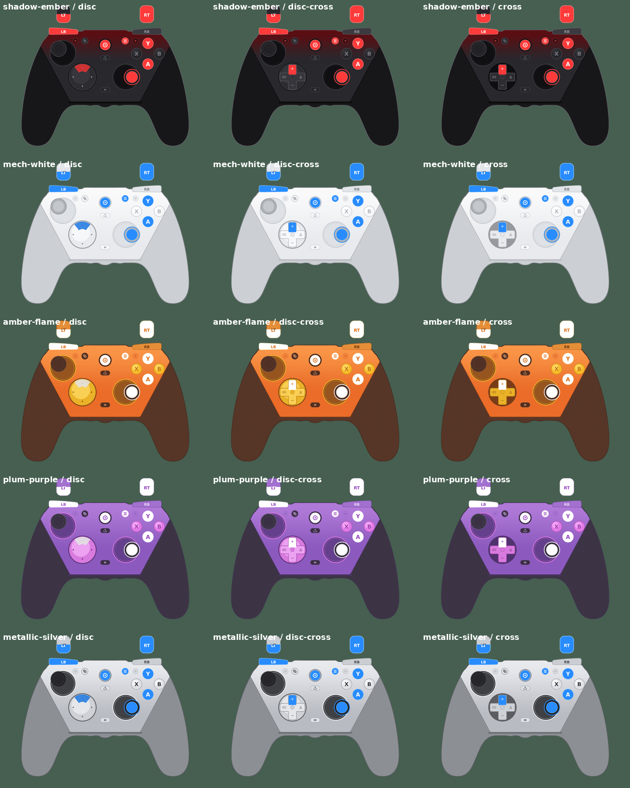

# GameSir G7 Pro

Gamepad overlay for the GameSir G7 Pro in all five standard colours, each with the three d-pads that come with the controller.

Created by Mobrin with the help of Claude AI (Anthropic).

## Usage

All textures share the same layout, so there is only **one config file** for every variant.

1. Add an **Input Overlay** source in OBS.
2. **Overlay image file:** pick the texture for your colour and d-pad (see table below)
3. **Overlay config file:** `gamesir-g7-pro.json`
4. Click **Reload gamepads** and select the controller in **Gamepad id**.

To switch colour or d-pad later, just pick a different image file. The config stays the same.

## Textures

File name pattern: `gamesir-g7-pro-<colour>-<d-pad>.png`

| Colour | `<colour>` |
|---|---|
| Shadow Ember (red/black) | `shadow-ember` |
| Mech White | `mech-white` |
| Amber Flame (orange) | `amber-flame` |
| Plum Purple | `plum-purple` |
| Metallic Silver | `metallic-silver` |

| D-pad | `<d-pad>` |
|---|---|
| Round disc with 4 dots (pre-installed) | `disc` |
| Round disc with raised cross (included) | `disc-cross` |
| Cross d-pad (included) | `cross` |

Example: Shadow Ember with the cross d-pad → `gamesir-g7-pro-shadow-ember-cross.png`

## Features

* A/B/X/Y, LB/RB, View, Menu and Guide light up when pressed
* D-pad directions light up individually (segment on the disc, arm on the cross d-pads)
* Analog sticks move and highlight on L3/R3 click
* LT/RT fill up analog from bottom to top

## Notes

* The controller is detected as a regular Xbox (XInput) controller.
* The extra buttons (L4/R4 back buttons, L5/R5 mini bumpers, M, Share) are not sent to Windows as separate inputs, so they are only decorative. Back buttons show up as whatever button they are mapped to.
