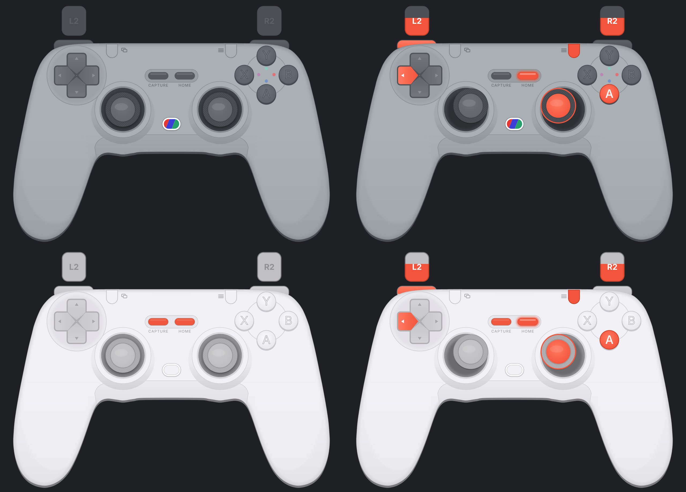

# GameSir Tegenaria Lite

Gamepad overlay for the GameSir Tegenaria Lite (wired, symmetric "retro" layout) in both standard colours.

Created by Mobrin with the help of Claude AI (Anthropic).

## Usage

Both textures share the same layout, so there is only **one config file**.

1. Add an **Input Overlay** source in OBS.
2. **Overlay image file:** pick the texture for your colour (see table below)
3. **Overlay config file:** `gamesir-tegenaria-lite.json`
4. Click **Reload gamepads** and select the controller in **Gamepad id**.

## Textures

| Colour | File |
|---|---|
| Retro Gray | `gamesir-tegenaria-lite-retro-gray.png` |
| Serene White | `gamesir-tegenaria-lite-serene-white.png` |

## Features

* A/B/X/Y, L1/R1, View, Menu and Home light up when pressed
* D-pad directions light up individually
* Analog sticks move and highlight on L3/R3 click
* L2/R2 fill up analog from bottom to top

## Notes

* On PC the controller is detected as a regular Xbox (XInput) controller. Home is shown as the Guide button.
* Capture and the two back buttons (L4/R4) are not sent to Windows as separate inputs, so they are only decorative. Back buttons show up as whatever button they are mapped to.
* All artwork is drawn from scratch as vector graphics. No manufacturer photos, logos or wordmarks are used.
