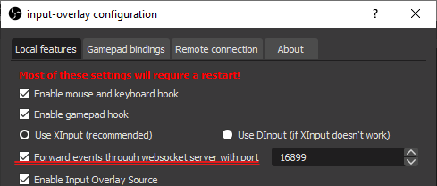

# input-history-windows-keyboard
By: [@christiankyle-ching](https://github.com/christiankyle-ching), [@Feddas](https://github.com/Feddas)

Displays input-history via a browser source in OBS. **Currently only shows keyboard events.**

## How to Enable?

1. Use a stable release of input-overlay. Because a [pre-release may not map keys correctly](https://github.com/univrsal/input-overlay/issues/474).
2. In OBS, add a `Browser` Source.
3. In the properties for that Browser Source:
    1. Enable the `Local File` checkbox
    1. Click browse to locate the `presets/input-history-windows/[input-history-windows.html](input-history-windows.html)`) file.
    1. (Optional) Modify `Width` & `Height` to match your display size or to change the size of the overlays.
4. In OBS go to `Tools/input-overlay settings` to enable websocket forwarding. 

    1. If websocket server was modified, close and restart OBS for it to take effect.
5. You should now see keystrokes being overlaid.
6. (Optional) [Customize](./Customize.md) which keys are shown, icons, fade, etc by editing the HTML file.

## Troubleshooting

1. If the key you're pressing doesn't match the key displayed in the overlay. Either:
    1. If you installed a pre-release version, uninstall input-overlay and switch to a [stable release](https://github.com/univrsal/input-overlay/releases/latest).
    1. Convert old presets using [the converter tool](https://univrsal.github.io/input-overlay/converter/) as described in the [5.1.0 release](https://github.com/univrsal/input-overlay/releases/tag/5.1.0) description.

